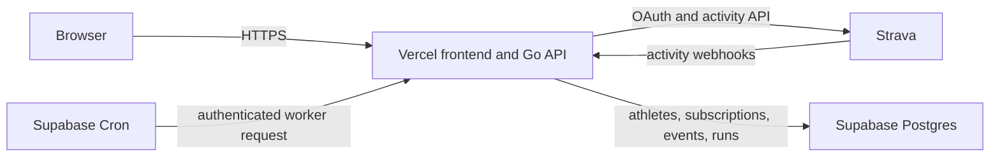

# Architecture

Strauto combines a React/Vite frontend with Go API functions on Vercel. Supabase Postgres stores connected athletes, automation subscriptions, queued webhook events, and durable activity-run history. A scheduled worker applies opted-in rules through the Strava API.

## Deployment boundaries

Deploy `apps/web` as the Vercel project root. `APP_URL` is the canonical origin, such as `https://strauto.example.com`, without a path. OAuth returns to `/api/oauth_callback`. The Strava app's authorization callback domain must match the hostname. A separate website can link to Strauto without sharing its deployment or credentials.

`/api/health` validates required configuration and reports whether automation settings are present. It does not prove external connectivity or event delivery. Verify the OAuth connection, webhook registration, scheduled worker, and a real activity separately using the [server setup guide](server-setup.md).

## Event processing and history

The callback URL has the form `/hooks/strava/<secret>`. A Vercel rewrite passes its secret path segment to the Go webhook handler. Verification GETs validate Strava's verification token and return its challenge. Event POSTs require the callback secret and matching subscription ID; only eligible activity-create events are queued.

The worker authenticates using a server-only secret, claims queued events, refreshes athlete tokens when needed, and checks activity ownership and type before applying a rule. Retries and duplicate webhooks do not inflate the dashboard's unique-activity counts. Run history is stored separately from the queue so queue cleanup can preserve counts.

## Data access

Server code uses the Supabase secret key. Client roles cannot directly access athlete tokens, queues, subscriptions, or run history. Dashboard reads are scoped to the signed-in athlete. Disabling an automation preserves its history; disconnecting or deauthorizing removes the athlete's data.

Keep local credentials, complete callback URLs, deployment identifiers, operational notes, and planning outside this public repository. Production credentials belong in the service secret stores; example configuration contains only placeholders.
