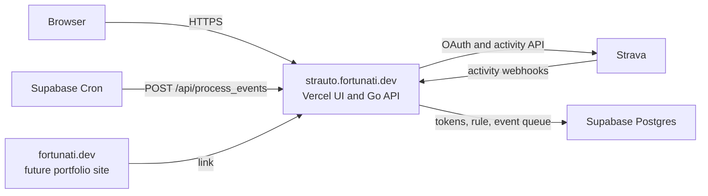

# Architecture and domain layout

The portfolio repository currently contains only a README. Keep the portfolio site and Strauto as separate deployments so work on either site can ship independently. The Strauto subdomain is already connected to Vercel.

| Public address | Project | Purpose |
| --- | --- | --- |
| `https://fortunati.dev` | Future portfolio project | Personal site and a link to Strauto |
| `https://strauto.fortunati.dev` | Existing Strauto Vercel project, root `apps/web` | React app and Go functions under `/api` |

`APP_URL` is the canonical Strauto origin, `https://strauto.fortunati.dev`, without a path. The OAuth callback is `https://strauto.fortunati.dev/api/oauth_callback`. The Strava API application's authorization callback domain should be `strauto.fortunati.dev`; Strava separately allows `localhost` for local development. The webhook callback and worker endpoint live under the same Strauto origin. No portfolio code or reverse proxy is needed for them.

The current `strauto.fortunati.dev` CNAME points to Vercel, and the site responds over HTTPS. Following the October 25, 2026 rollout, `/api/health` returns `200` with `status: configured` and `automation_configured: true`. This endpoint validates configuration; separate live checks verified the worker's Supabase access and Strava's callback verification. Keep the portfolio and Strauto as separate hosting projects with their own Git repositories and environment variables.

The October 25 dashboard rollout is deployed: `002_automation_history.sql` is applied, the once-per-minute scheduled worker returns HTTP 200, and the Strava webhook subscription is registered. Connecting an athlete and verifying the first real upload remain outstanding. See the [rollout status](rollout-status.md) for verified results and remaining steps, and the [server setup sequence](server-setup.md) for configuration instructions.

The webhook callback uses an unguessable secret path segment, rewritten internally to the handler's `key` parameter, and verifies Strava's subscription ID on event POSTs. Strava's general webhook documentation does not specify a POST signature, although its separate example mentions one without explaining how to obtain a signing secret. Verify the callback URL and delivered headers during the first live subscription setup. Keep the callback URL secret; rotate the key if it leaks.
